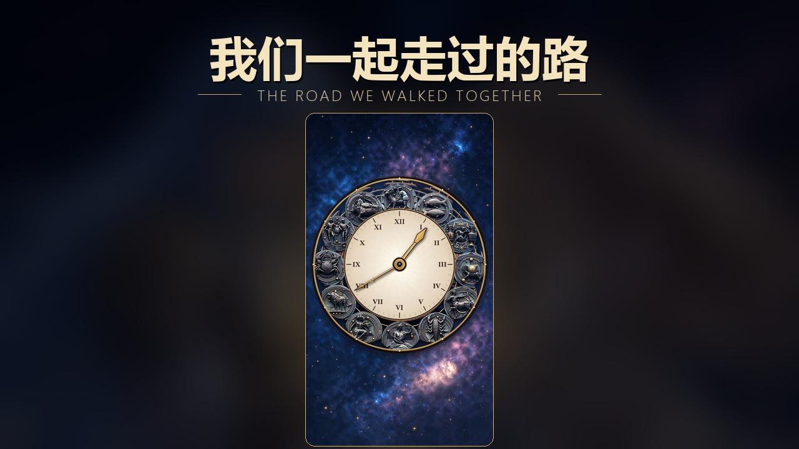

# 我们一起走过的路 · 黄道十二宫

一个使用 **PyCharm + Anaconda + PySide6/QtWebEngine** 制作的交互式动态壁纸。

开场先播放双人视频，视频结束后画面缓慢浮现黄道十二宫时钟；背景继续循环播放经过虚化的视频，并循环播放《素颜》作为背景音乐。点击时钟上的 **I（双鱼座）** 或 **VIII（狮子座）** 星徽，会打开对应的人物档案。

> 项目目录与启动脚本仍沿用旧名 `星海之约`，不影响页面主题。
>
> 开场与背景视频均以静音方式播放，符合浏览器与壁纸软件的自动播放策略；背景音乐与开场视频同步开始，并可在右上角随时暂停或继续。
>
> 公开页面与 GitHub 仓库只保存人物档案和照片的密文；输入访问密码后，浏览器才会解密并显示真实姓名与照片。



---

## 一、运行环境

| 项目 | 本机路径 / 版本 |
| --- | --- |
| Python | `D:\anaconda\python.exe`（Anaconda，Python 3.14.6） |
| GUI / Web 引擎 | PySide6 6.11.0 + QtWebEngine |
| IDE | PyCharm 2026.2.3（`D:\pycharm\PyCharm 2026.2.3`） |
| 视频 | H.264 MP4 + VP9 WebM 双格式 |

> QtWebEngine 在这台机器上无法解码 H.264，因此项目额外提供了 `star_sea.webm`。
> 浏览器 / Lively 会优先播放 WebM，Python 宿主也能正常播放；MP4 作为兼容回退保留。

---

## 二、启动方式

### 1. 双击启动（推荐）

双击项目根目录的 **`启动星海之约.bat`**。

脚本会用 `D:\anaconda\pythonw.exe` 启动 `app.py`，不显示控制台窗口。

### 2. 在 PyCharm 中启动

1. 打开 PyCharm，选择 **File → Open**，打开文件夹 `C:\Users\1\Documents\默认项目\星海之约`。
2. 项目已附带 `.idea` 配置，解释器为 **Anaconda (D:\anaconda)**。
3. 右上角运行配置选择：
   - **星海之约 · 全屏启动**：正式全屏运行；
   - **星海之约 · 窗口调试**：1280×800 窗口运行，方便调试。
4. 点击绿色三角运行。

### 3. 命令行启动

```powershell
cd "C:\Users\1\Documents\默认项目\星海之约"
& "D:\anaconda\python.exe" app.py
```

调试参数：

```powershell
# 窗口模式
& "D:\anaconda\python.exe" app.py --windowed

# 跳过开场，直接看主画面
& "D:\anaconda\python.exe" app.py --windowed --preview

# 从视频结尾前 1.4 秒开始，快速测试过渡
& "D:\anaconda\python.exe" app.py --windowed --intro-test

# 自动打开某个人物档案
& "D:\anaconda\python.exe" app.py --windowed --preview --modal pisces
& "D:\anaconda\python.exe" app.py --windowed --preview --modal leo

# 显示两个星徽热点的位置，方便换图后校准
& "D:\anaconda\python.exe" app.py --windowed --preview --spots
```

---

## 三、操作说明

| 操作 | 效果 |
| --- | --- |
| 点击 **I** 星徽 | 打开双鱼座的人物档案 |
| 点击 **VIII** 星徽 | 打开狮子座的人物档案 |
| 点击右上角音乐按钮 | 暂停 / 继续背景音乐《素颜》 |
| `Esc` / 点击遮罩 / 右上角 × | 关闭人物档案 |
| 点击「跳过开场」 | 立即进入时钟画面 |
| `F11` | 切换全屏 / 窗口 |
| `F5` | 重新加载页面 |
| `Ctrl+Q` | 退出程序 |

鼠标静止约 2.6 秒后会自动隐藏，移动后恢复，更接近壁纸效果。

---

## 四、文件结构

```text
星海之约/
├─ app.py                      Python 全屏宿主（PySide6 + QtWebEngine）
├─ 启动星海之约.bat            双击启动脚本
├─ requirements.txt           运行依赖
├─ README.md
├─ .github/
│  └─ workflows/pages.yml      GitHub Pages 自动部署
├─ .gitignore                  公开仓库忽略规则
├─ .idea/                     PyCharm 项目与运行配置（不发布）
├─ private/                   隐私源文件与密钥（不发布）
│  ├─ profiles.json           人物姓名、文案、标签
│  ├─ portraits/              人物原始照片
│  └─ data-key.bin            数据密钥
├─ tools/
│  ├─ convert_video.py        把视频转换为 VP9 WebM 的工具
│  ├─ encrypt_private.py      加密人物档案与照片
│  └─ set_password.py         修改网页访问密码
└─ web/
   ├─ index.html              页面结构
   ├─ style.css               视觉、开场浮现、背景虚化、热点、弹窗样式
   ├─ app.js                  开场结束逻辑、档案弹窗、音乐控制
   ├─ lock.js                 密码校验与数据密钥解包
   ├─ private-crypto.js       浏览器端解密人物档案与照片
   ├─ local-key.js            本地 file:// 密钥（不发布）
   ├─ .nojekyll               关闭 GitHub Pages 的 Jekyll 处理
   ├─ LivelyInfo.json         Lively Wallpaper 导入信息（可选）
   └─ assets/
      ├─ star_sea.webm        开场 / 循环背景（QtWebEngine 必需）
      ├─ star_sea.mp4         视频回退（浏览器 / Lively）
      ├─ zodiac_clock.jpg     黄道十二宫时钟（1125×2000）
      ├─ enc/
      │  ├─ profiles.enc.js   加密的人物档案
      │  └─ portraits.enc.js  加密的人物照片
      ├─ suyan.ogg             背景音乐《素颜》（QtWebEngine 主格式）
      ├─ suyan.mp3             背景音乐回退（浏览器 / Lively）
      ├─ poster.jpg           视频海报 / 加载占位
      ├─ thumbnail.jpg        预览缩略图
      ├─ icon.png             应用图标
      └─ noise.png            胶片颗粒纹理
```

---

## 五、自定义修改

### 1. 修改人物姓名、文案、标签、数值

人物资料保存在本地 **`private/profiles.json`**，不会进入公开仓库。每个角色包含：

```json
{
  "pisces": {
    "id": "I",
    "sign": "双鱼座",
    "glyph": "♓︎",
    "name": "角色名",
    "title": "昵称",
    "element": "水",
    "planet": "海王星",
    "age": "24",
    "coords": "RA 00h 49m · DEC +07°",
    "coordsShort": "00h 49m",
    "tags": ["温柔", "共情", "浪漫", "梦境"],
    "quote": "……",
    "desc": "……",
    "bond": "……",
    "portraitKey": "pisces"
  }
}
```

人物照片放在 `private/portraits/`，文件名与 `portraitKey` 对应，例如 `pisces.jpg`、`leo.jpg`。修改资料或照片后运行：

```powershell
cd "C:\Users\1\Documents\默认项目\星海之约"
& "D:\anaconda\python.exe" "tools\encrypt_private.py"
```

脚本会重新生成 `web/assets/enc/profiles.enc.js` 与 `web/assets/enc/portraits.enc.js`。提交并推送这些密文文件后，线上页面会在解锁时显示新内容。

> `private/`、`web/local-key.js` 与 `private/data-key.bin` 已被 Git 忽略。不要把它们上传到公开仓库，也不要删除 `data-key.bin`，否则需要重新加密全部素材。

### 2. 修改星徽位置

打开 **`web/style.css`**：

```css
.hotspot--pisces {
  --x: 66.9%;
  --y: 27.9%;
}

.hotspot--leo {
  --x: 16.9%;
  --y: 54.5%;
}
```

`--x` / `--y` 是相对于时钟图片的百分比。换图后可用下面的命令显示热点位置再微调：

```powershell
& "D:\anaconda\python.exe" app.py --windowed --preview --spots
```

### 3. 替换时钟图片

用同名文件覆盖 **`web/assets/zodiac_clock.jpg`** 即可，建议保持 9:16 竖版比例（例如 1125×2000）。

### 4. 替换视频

1. 把新视频放到 `web/assets/`，例如 `new_video.mp4`。
2. 转换为 QtWebEngine 可播放的 WebM：

```powershell
& "D:\anaconda\python.exe" "tools\convert_video.py" "web\assets\new_video.mp4"
```

3. 把生成的 `new_video.webm` 和原 `new_video.mp4` 改名或覆盖为：
   - `web/assets/star_sea.webm`
   - `web/assets/star_sea.mp4`
4. 如需更换视频封面，用视频截图覆盖 `web/assets/poster.jpg`。

> 只替换 MP4 也能在 Chrome / Edge / Lively 中播放，但 Python 宿主必须使用 WebM。

### 5. 调整虚化强度与整体色调

在 **`web/style.css`** 中修改：

```css
.video--bg {
  filter: blur(16px) saturate(1.24) brightness(0.52);
}
```

- `blur()` 越大，背景越抽象；
- `brightness()` 控制背景明暗；
- 页面顶部的 `:root` 中可以统一修改金色、水色、火色等主题变量。

### 6. 调整开场浮现速度

在 `web/style.css` 中搜索 `.portrait` 的 `transition`：

```css
transition:
  opacity 2.25s ease 0.08s,
  transform 2.9s var(--ease-out) 0.08s,
  filter 2.35s ease 0.08s;
```

修改秒数即可。视频结束后由 `web/app.js` 中的 `markRevealed()` 添加 `revealed` 类触发动画。

### 7. 更换背景音乐

当前循环播放《素颜》，对应文件：

- `web/assets/suyan.ogg`：Python / QtWebEngine 使用；
- `web/assets/suyan.mp3`：浏览器 / Lively 的回退格式。

替换时保持文件名不变即可。QtWebEngine 可能无法解码 MP3，建议同时提供 OGG Vorbis 版本；音量可在 `web/app.js` 的 `MUSIC_VOLUME` 中调整（默认 `0.46`）。

> 根目录的原始音乐文件是网易云 NCM 加密格式，不能直接作为网页音频；已导出为 `web/assets/suyan.ogg` 与 `suyan.mp3`。

---

## 六、作为 Lively Wallpaper 使用（可选）

`web` 文件夹本身也是一套完整的 Web 壁纸，附带 `LivelyInfo.json`。

1. 打开 Lively Wallpaper；
2. 选择「添加壁纸」/ 拖入 **`web` 文件夹**；
3. 选择「我们一起走过的路」应用。

Lively 使用 WebView2，可直接播放 MP4；点击交互是否可用取决于 Lively 的输入设置。

---

## 七、常见问题

### 页面黑屏 / 控制台出现 `loadFinished: False`

本机 QtWebEngine 的多进程渲染器无法创建共享 GL 上下文。`app.py` 已固定加入：

```text
--single-process --no-sandbox
```

如果换到显卡驱动正常的电脑，可以尝试删除这两个参数，以恢复多进程渲染。

### 视频只有声音或黑屏

QtWebEngine 不支持 H.264。确认 `web/assets/star_sea.webm` 存在，并且 `index.html` 中 WebM `<source>` 排在 MP4 前面。

### 开场没有自动播放

页面已设置 `muted`。若仍被拦截，会出现「轻触 · 进入星海」入口，点击即可播放。

### 关闭程序

按 `Ctrl+Q`，或直接关闭全屏窗口（`Alt+F4`）。

---

## 八、依赖安装

项目运行只需要 PySide6（本机已安装）：

```powershell
& "D:\anaconda\python.exe" -m pip install -r requirements.txt
```

仅当需要重新转换视频时，才需要 `imageio-ffmpeg`：

```powershell
& "D:\anaconda\python.exe" -m pip install imageio-ffmpeg
```

---

素材与人物设定来自项目作者提供，仅用于个人展示。

---

## 九、发布到 GitHub Pages（可选）

线上版本只部署 `web/` 目录；Python 宿主、`private/` 隐私源文件、本地密钥和加密音乐源文件不会进入网站。

### 1. 访问密码与隐私数据

通过 `http://` 或 `https://` 打开时会先显示密码页；本地 `file://` 壁纸使用 `web/local-key.js` 直接解锁。

密码除了校验访问权限，还会解开保存在 `web/lock.js` 中的 AES-GCM 数据密钥。真实姓名、文案与照片只以密文形式存放在 `web/assets/enc/`，公开仓库页面无法直接看到明文。解锁后，数据密钥仅保存在当前标签页的 `sessionStorage`，关闭标签页后需要重新输入密码。

密码配置位于 `web/lock.js` 顶部的 `PASSWORD_CONFIG`，包含 PBKDF2-SHA256 校验值和加密后的数据密钥。修改密码：

```powershell
cd "C:\Users\1\Documents\默认项目\星海之约"
& "D:\anaconda\python.exe" "tools\set_password.py"
```

输入并确认新密码后，脚本会更新 salt、校验值和数据密钥的包装，不需要重新加密照片。提交并推送后生效。

> 前端密码只能挡住普通访客，不能提供绝对保密。知道密码的人仍然可以在浏览器中查看和保存解密后的照片；请勿放入高度敏感的隐私资料。

本地模拟线上环境：

```powershell
& "D:\anaconda\python.exe" -m http.server 8000 --directory web
```

然后访问 `http://localhost:8000/`。

### 2. 自动部署

`.github/workflows/pages.yml` 会在每次推送到 `main` 分支时，把 `web/` 目录发布到 GitHub Pages。工作流会尝试自动为仓库启用 Pages；如果自动启用失败，请在 GitHub 仓库的 **Settings → Pages → Build and deployment → Source** 手动选择 **GitHub Actions**。发布后的地址：

```text
https://<GitHub 用户名>.github.io/our-walked-road/
```

